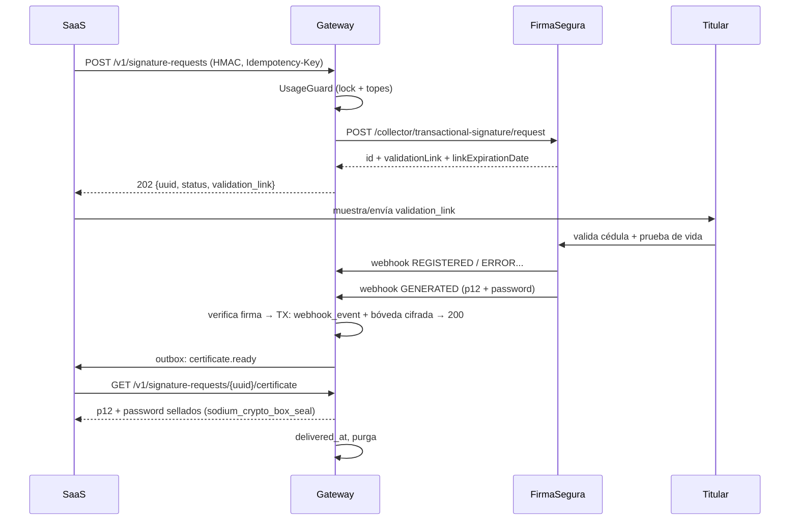

# Signing Gateway — Arquitectura

Microservicio aislado que centraliza la emisión de certificados de firma electrónica para el SaaS.
Hoy integra **FirmaSeguraEC**; está diseñado para añadir otros proveedores sin tocar el SaaS.

> Estado: borrador de diseño, previo a desarrollo. Fecha: 2026-10-18.

---

## 1. Decisiones base

| Tema | Decisión | Fuente |
|---|---|---|
| Framework | **Laravel 13** (`^13.0`), PHP **8.3+** (recomendado 8.4). Soporte de seguridad hasta 2028-03-17. | laravel.com/docs/13.x/releases |
| Estructura | Directorios por defecto de Laravel + un módulo `app/Signing`. Laravel "impone casi ninguna restricción" sobre dónde vive una clase mientras Composer la cargue. | laravel.com/docs/13.x/structure |
| Enums (todos) | `spatie/laravel-enum` **3.3** (soporta Laravel 11–13, PHP ^8.2), también para roles y permisos. | packagist / README |
| Roles y permisos con spatie enums | `spatie/laravel-permission` solo reconoce objetos `\BackedEnum`; con clases spatie se pasa siempre **`->value`** (string), p. ej. `$client->hasPermissionTo(Permission::requestsCreate()->value)`. | spatie.be/docs/laravel-permission/v8/basic-usage/enums |
| Permisos | `spatie/laravel-permission` **v8** (Laravel 12/13, PHP 8.3+). Guards separados `web` (operadores) y `api` (clientes máquina). | spatie.be/docs/laravel-permission/v8 |
| Listados / filtros | `spatie/laravel-query-builder` **v7** (Laravel 12+, PHP 8.3+). | spatie.be/docs/laravel-query-builder/v7 |
| Fechas | **Carbon**. Todo se persiste en **UTC**; las fechas del proveedor (`yyyy-MM-dd HH:mm:ss`, `America/Guayaquil`) se convierten al entrar. | — |
| Cifrado | `Illuminate\Encryption\Encrypter` con **llave propia para la bóveda** (no `APP_KEY`). Rotación con el mismo esquema de `APP_PREVIOUS_KEYS`. | laravel.com/docs/13.x/encryption |
| Colas | Redis + Laravel Queues (Horizon opcional). | — |
| BD | PostgreSQL o MySQL 8 **propia del gateway**, nunca compartida con el SaaS. | — |

---

## 2. Topología

```
                 WireGuard (solo IP Plesk)                    Salida solo a api.firmaseguraec.com
[SaaS / Plesk] ─────────────────────────────► [Gateway] ───────────────────────────────────────► [FirmaSegura]
      ▲   API interna  :8443 (wg0)                │  ▲                                              │
      │                                           │  │  Webhook público :443  /webhooks/{provider}/{account}
      └──── notificaciones firmadas (outbox) ─────┘  └──────────────── solo IPs del proveedor ◄──────┘
```

- **Dos superficies HTTP separadas**: API interna (escucha solo en la interfaz del túnel) y webhook público (nginx, una sola ruta, IP allowlist del proveedor).
- El **token del proveedor existe solo en el gateway**, restringido por IP en FirmaSegura a la IP del gateway.
- Un gateway (o configuración) por ambiente: `sandbox` → `api.dev-firmaseguraec.com`, `production` → `api.firmaseguraec.com`.

---

## 3. Abstracción multi‑proveedor

### 3.1 Productos internos (independientes del proveedor)

El SaaS habla en **productos internos**; cada driver los traduce al flujo concreto del proveedor.

| Producto interno | FirmaSegura | Endpoint de registro | Resultado |
|---|---|---|---|
| `REGULAR` | Firmas Regulares | `POST /collector/request` (envía cédula, selfie, PDFs) | Validación manual; estado por `GET /middleware/signature-request/status` |
| `TRANSACTIONAL` | Firmas Transaccionales | `POST /collector/transactional-signature/request` | Link de validación → webhook `GENERATED` con **p12 + password**; o `GET /manager/transactional-signature/result` (**una sola vez**) |
| `LINKED_PARTNER` | Tercero Vinculado | `POST /collector/linked-partner/request` (con `evidences`, `callbackUrl` obligatorio) | Webhook de éxito con `file` + `password`; reintento/cancelación/reenvío; p12 por endpoint de **una sola vez** |
| `SIMPLIFIED` | Flujo simplificado | `POST /signature/traditional/request` | `link` + `sessionId`; webhooks **CloudEvents 1.0** (`session.completed`, `rejected`, `error`, `cancelled`, `expired`) |
| `HEADLESS` | Flujo por API | TyC → Solicitud → Validación identidad → FaceLiveness → Emisión | Sin frontend del proveedor: el SaaS (o el gateway) conduce cada paso |
| `POS_VOUCHER` | Flujo POS | Vigencias vendibles → Cobrar y emitir cupón | Cupón de un solo uso (24 h); el canje origina una solicitud `SIMPLIFIED`. **Sin notificación** al aliado → requiere polling |

### 3.2 Contratos por capacidad

No todos los proveedores ofrecen todos los flujos, así que un driver implementa solo las capacidades que tiene:

```php
namespace App\Signing\Contracts;

interface SignatureProvider            // identidad del driver
{
    public function name(): string;
    public function supports(ProductType $product): bool;
}

interface RegistersRequests            { public function register(RegisterRequestData $data): ProviderRegistration; }
interface QueriesStatus                { public function status(SignatureRequest $request): ProviderStatusData; }
interface CancelsRequests              { public function cancel(SignatureRequest $request, string $reason): void; }
interface RetriesRequests              { public function retry(SignatureRequest $request): void; }
interface RetrievesCertificates        { public function retrieveCertificate(SignatureRequest $request): CertificateData; }
interface RevokesCertificates          { public function revoke(SignatureRequest $request, string $reason): void; }
interface SellsVouchers                { public function products(): Collection; public function sell(SellVoucherData $data): VoucherData; }
interface DrivesHeadlessFlow           { /* terms(), identity(), livenessChallenge(), liveness(), issue() */ }
interface HandlesWebhooks
{
    public function verify(Request $request, ProviderAccount $account): bool;   // firma HMAC del proveedor
    public function parse(Request $request): NormalizedWebhookEvent;           // a evento interno
}
```

### 3.3 Resolución de drivers

`SignatureProviderManager extends Illuminate\Support\Manager` (el mismo patrón que usan Mail, Cache y Filesystem):

```php
$driver = app(SignatureProviderManager::class)->driver($account->provider->value); // 'firmasegura'
```

- `ProviderRouter` decide **qué cuenta de proveedor** atiende cada solicitud (producto, ambiente, prioridad, override por tenant).
- Cambiar de proveedor = registrar un nuevo driver + configurar `provider_products`. **El SaaS no cambia.**
- Los estados del proveedor se traducen a estados internos en un **Mapper** por driver; el estado crudo se guarda también (`provider_status`).

---

## 4. Estructura del proyecto

```
app/
├── Console/Commands/           # rotación de llaves, purga, conciliación manual
├── Enums/                      # spatie/laravel-enum (dominio) + enums nativos (Role, Permission)
├── Events/  Listeners/         # SignatureRequestIssued, CertificateStored, LimitExceeded…
├── Exceptions/                 # ProviderUnavailable, LimitExceededException, CertificateAlreadyDelivered…
├── Http/
│   ├── Controllers/Api/V1/     # SignatureRequestController, VoucherController, CertificateController
│   ├── Controllers/Webhooks/   # ProviderWebhookController
│   ├── Middleware/             # VerifyClientSignature (HMAC), EnsureInternalNetwork
│   ├── Requests/               # FormRequests por producto (TransformsEnums)
│   └── Resources/              # respuestas sin datos sensibles
├── Jobs/                       # SubmitToProvider, ProcessWebhookEvent, FetchCertificate,
│                               # ReconcileRequest, DeliverClientNotification, PurgeExpiredData
├── Models/
├── Policies/
├── Providers/                  # AppServiceProvider, SigningServiceProvider (registra drivers)
├── Rules/                      # Cedula, FingerCode, EcuadorCellphone, Ruc
└── Signing/
    ├── Contracts/
    ├── Data/                   # DTOs readonly (RegisterRequestData, CertificateData…)
    ├── Drivers/FirmaSegura/    # Driver, HttpClient, Mappers/, WebhookVerifier, Payloads/
    ├── Limits/UsageGuard.php   # topes duros
    ├── Routing/ProviderRouter.php
    ├── Vault/CertificateVault.php
    └── SignatureProviderManager.php
routes/
├── api.php                     # API interna v1 (stateless)
└── webhooks.php                # registrado aparte, sin sesión ni CSRF
```

---

## 5. Modelo de datos

| Tabla | Propósito | Campos clave |
|---|---|---|
| `api_clients` | Instancias del SaaS que consumen el gateway | `id` (UUIDv7), `name`, `hmac_secret` (cifrado), `public_key` (para entrega sellada), `allowed_ips`, `is_active` |
| `tenants` | Espejo mínimo de tenants del SaaS | `external_id`, `api_client_id`, `daily_cap`, `hourly_cap`, `is_suspended` |
| `provider_accounts` | Credenciales por proveedor y ambiente | `provider` (enum), `environment`, `credentials` (cifrado), `webhook_secret` (cifrado), `priority`, `is_active` |
| `provider_products` | Traducción producto/periodo → código del proveedor | `provider_account_id`, `product`, `period`, `provider_code`, `unit_cost` |
| `signature_requests` | Solicitud canónica | `id` (UUIDv7), `tenant_id`, `api_client_id`, `provider_account_id`, `product`, `period`, `status`, `provider_status`, `reference_transaction` (único; = id), `idempotency_key` (único por cliente), `provider_request_id`, `provider_session_id`, `applicant` (json cifrado), `validation_link` (cifrado), `link_expires_at`, `issued_at`, `valid_from`, `valid_until`, `revoked_at` |
| `signature_request_transitions` | Historial de estados | `from`, `to`, `source` (api / webhook / reconcile), `created_at` |
| `certificate_vault` | p12 cifrado | `signature_request_id`, `payload` (cifrado), `password` (cifrado, otra llave), `sha256`, `received_at`, `delivered_at`, `purged_at` |
| `webhook_events` | Deduplicación y trazabilidad | `provider`, `external_id` (CloudEvents `id` o `reference+status`), `signature_valid`, `payload` (**cifrado; contiene password**), `processed_at` |
| `vouchers` | Cupones POS | `voucher_uid`, `external_reference` (idempotencia), `expires_at`, `redeemed_signature_request_id` |
| `usage_ledger` | Conteo para topes y conciliación | `tenant_id`, `product`, `bucket_hour`, `count` |
| `client_notifications` | Outbox hacia el SaaS | `signature_request_id`, `event`, `payload`, `attempts`, `delivered_at` |
| `audit_logs` | Solo inserción | `actor_type`, `actor_id`, `action`, `subject`, `ip`, `context`, `created_at` |

**Datos biométricos y documentos** (selfie, cédula, PDFs, video): se reenvían al proveedor y **no se persisten**. Si hace falta para reintentar, se guardan cifrados con un TTL corto y `PurgeExpiredData` los elimina (LOPDP: minimización y retención).

---

## 6. Enums

```php
// Dominio — spatie/laravel-enum
/**
 * @method static self REGULAR()
 * @method static self TRANSACTIONAL()
 * @method static self LINKED_PARTNER()
 * @method static self SIMPLIFIED()
 * @method static self HEADLESS()
 * @method static self POS_VOUCHER()
 */
final class ProductType extends \Spatie\Enum\Laravel\Enum {}

// También: RequestStatus, Provider, Environment, CertificatePeriod, ApplicationType, WebhookEventType
```

Uso: `$casts = ['status' => RequestStatus::class]`, validación con `new EnumRule(RequestStatus::class)` y `TransformsEnums` en los FormRequests.

```php
// Roles y permisos — también spatie/laravel-enum; values() fija el nombre guardado en BD
/**
 * @method static self requestsCreate()
 * @method static self requestsView()
 * @method static self requestsCancel()
 * @method static self certificatesRetrieve()
 * @method static self vouchersSell()
 * @method static self limitsManage()
 * @method static self providersManage()
 * @method static self auditView()
 */
final class Permission extends \Spatie\Enum\Laravel\Enum
{
    protected static function values(): array
    {
        return [
            'requestsCreate'       => 'signature-requests.create',
            'requestsView'         => 'signature-requests.view',
            'requestsCancel'       => 'signature-requests.cancel',
            'certificatesRetrieve' => 'certificates.retrieve',
            'vouchersSell'         => 'vouchers.sell',
            'limitsManage'         => 'limits.manage',
            'providersManage'      => 'providers.manage',
            'auditView'            => 'audit.view',
        ];
    }
}

/**
 * @method static self superAdmin()
 * @method static self operator()
 * @method static self auditor()
 * @method static self saasClient()   // guard api
 */
final class Role extends \Spatie\Enum\Laravel\Enum
{
    protected static function values(): array
    {
        return ['superAdmin' => 'super-admin', 'saasClient' => 'saas-client'];
    }
}
```

Regla con spatie/laravel-permission: **siempre `->value`** (`assignRole(Role::operator()->value)`, `can(Permission::auditView()->value)`, middleware `permission:` con el string). El seeder recorre `Permission::cases()` para crear los registros.

### Máquina de estados interna (`RequestStatus`)

```
DRAFT → SUBMITTING → SUBMITTED → AWAITING_APPLICANT → VALIDATING → APPROVED → ISSUED → CERTIFICATE_STORED → DELIVERED
                         │               │                │            │
                         └──────► REJECTED / CANCELLED / EXPIRED / FAILED          ISSUED/DELIVERED → REVOKED
```

Las transiciones válidas se definen en un único lugar; una transición inválida lanza una excepción y se audita.

---

## 7. Flujos clave

### 7.1 Alta de solicitud (SaaS → gateway → proveedor)

1. El SaaS envía `POST /v1/signature-requests` con `Idempotency-Key`, `X-Client-Id`, `X-Timestamp` y `X-Signature` (HMAC-SHA256 del cuerpo crudo + timestamp; ventana de 5 min).
2. Middleware: verifica HMAC, IP del túnel y token del cliente; aplica `RateLimiter`.
3. El FormRequest del producto valida los datos (cédula, código dactilar, celular `+5939…`, ciudad y provincia según la lista del proveedor).
4. `UsageGuard` toma un `Cache::lock` por tenant y comprueba los **topes duros** (por tenant y global). Si se superan, responde 429, emite el evento `LimitExceeded` y envía una alerta.
5. Se crea la `SignatureRequest` con `reference_transaction = id (UUIDv7)` en estado `SUBMITTING`, y se encola `SubmitToProvider`.
6. El job llama al driver. Si el proveedor responde 409 "Ya existe el id de transacción", se trata como éxito idempotente y se consulta el estado.
7. Se guardan los IDs y el link. El SaaS recibe el link por la respuesta (síncrona opcional) o por el outbox.

Middleware de los jobs (job middleware de Laravel): `RateLimited` (respetar los límites del proveedor), `ThrottlesExceptions` (actúa como cortacircuitos si el proveedor cae) y `WithoutOverlapping` por solicitud.

### 7.2 Webhook con certificado (crítico: entrega de una sola vez)

1. nginx deja pasar solo las IPs del proveedor hacia `/webhooks/firmasegura/{account_uuid}`.
2. `driver->verify()` comprueba la firma HMAC del proveedor sobre el **cuerpo crudo** con `hash_equals`. Si no es válida, responde 401 y queda auditado.
3. En **una transacción de BD**: se inserta en `webhook_events` (si es duplicado, se responde 200 sin hacer nada más) y, si trae certificado, se cifra y guarda en `certificate_vault`.
4. Tras el commit se responde **200**. Todo lo demás corre en `ProcessWebhookEvent`, en cola.
5. El job aplica la transición de estado y verifica el `sha256` y que el p12 abra con su password (`openssl_pkcs12_read`). Luego genera la notificación en el outbox.
6. Nunca se toma el webhook como única fuente de verdad: para los cambios de estado sin certificado, se confirma con `status()`.

### 7.3 Entrega del certificado

**Decidido (2026-10-18):** el modo depende de quién recibe el certificado según el flujo del proveedor.

| Flujo | ¿El p12 llega al gateway? | Entrega |
|---|---|---|
| `SIMPLIFIED` | No (el proveedor lo emite y envía al titular) | **Directo al titular** por el proveedor; el gateway solo informa estados al SaaS |
| `POS_VOUCHER` | No (el canje origina un simplificado) | **Directo al titular** |
| `REGULAR` | No (solo estados) | **Directo al titular** |
| `TRANSACTIONAL` | Sí: webhook `GENERATED` / `GET /manager/transactional-signature/result` | **Al SaaS, sellado** |
| `LINKED_PARTNER` | Sí: webhook de éxito / endpoint p12 de una sola vez | **Al SaaS, sellado** |
| `HEADLESS` | Sí: `POST /signature/api/session/{sessionId}/issuance` devuelve `certificateBase64` + `password` | **Al SaaS, sellado** |

Entrega al SaaS: el gateway notifica por el outbox `certificate.ready` y el SaaS lo retira con `GET /v1/signature-requests/{uuid}/certificate` **una sola vez**. El p12 y el password viajan **sellados con la llave pública del cliente** (`sodium_crypto_box_seal`); solo el SaaS puede abrirlos. Tras confirmar la entrega (`delivered_at`), la bóveda se purga según la retención. El modo se guarda como `DeliveryMode` (`HOLDER` / `CLIENT_SEALED`) derivado del producto, no elegido por el SaaS.

A partir de aquí la custodia del p12 es responsabilidad del SaaS: debe guardarlo cifrado con una llave fuera de su BD.

### 7.4 Conciliación (scheduler)

- **Cada 5 min:** solicitudes estancadas (`SUBMITTED`, `VALIDATING` con más de N minutos) → `status()`.
- **Cada 15 min:** cupones POS vigentes, porque el proveedor no notifica el canje.
- **Diario:** se compara `usage_ledger` contra el consumo descontado en el SaaS y contra el reporte del proveedor. Cualquier diferencia genera una alerta.
- **Diario:** purga de documentos temporales, payloads de webhook y bóveda ya entregada.

---

## 8. API interna (v1)

| Método | Ruta | Permiso |
|---|---|---|
| `POST` | `/v1/signature-requests` | `signature-requests.create` |
| `GET` | `/v1/signature-requests` | `signature-requests.view` — `filter[status]`, `filter[product]`, `filter[tenant]`, `filter[created_between]`, `sort=-created_at` (query-builder) |
| `GET` | `/v1/signature-requests/{uuid}` | `signature-requests.view` |
| `POST` | `/v1/signature-requests/{uuid}/cancel` | `signature-requests.cancel` |
| `POST` | `/v1/signature-requests/{uuid}/retry` | `signature-requests.create` |
| `POST` | `/v1/signature-requests/{uuid}/resend-email` | `signature-requests.create` |
| `GET` | `/v1/signature-requests/{uuid}/certificate` | `certificates.retrieve` (una vez) |
| `POST` | `/v1/signature-requests/{uuid}/headless/{step}` | `signature-requests.create` (flujo por API) |
| `GET` | `/v1/products` | `signature-requests.view` (catálogo interno + vigencias) |
| `POST` | `/v1/vouchers` | `vouchers.sell` (`externalReference` obligatorio) |
| `GET` | `/v1/vouchers/{uid}` | `vouchers.sell` |

Todas las consultas se limitan a los tenants del cliente que hace la llamada, con un scope global y una Policy. Las respuestas **nunca** incluyen documentos, biometría ni passwords.

---

## 9. Seguridad (checklist)

**Red:** firewall con *deny all*. Entrada permitida solo por WireGuard desde la IP de Plesk y por 443 desde las IPs del proveedor. Salida permitida solo a los dominios del proveedor, DNS, NTP y repositorios de actualización.
**Secretos:** token del proveedor, llaves de la bóveda y secretos HMAC fuera del repositorio. Se cargan con `LoadCredential` de systemd o un archivo `600`. Las llaves de la bóveda son distintas de `APP_KEY`.
**Token del proveedor:** restringido por IP en FirmaSegura, y con un procedimiento de rotación documentado.
**Límites:** topes duros en el gateway, independientes de los cupos del SaaS, con alertas y corte automático.
**Logs:** se enmascaran cédula, email y celular. Nunca se registran payloads, passwords ni base64.
**App:** `APP_DEBUG=false`, sin Telescope ni Debugbar en producción. Horizon y Pulse solo en la interfaz interna. Paquetes de Composer mínimos y auditados con `composer audit`.
**Datos personales (LOPDP):** registro de actividades de tratamiento, política de retención y evaluación de impacto (DPIA) por el tratamiento de datos biométricos.

---

## 10. Escalabilidad

- **Nodos sin estado:** la app web y los workers escalan horizontalmente. Redis centraliza colas, locks y rate limits.
- **Colas separadas por prioridad:** `webhooks` (alta), `provider` (llamadas salientes), `notifications`, `maintenance`.
- **Un mismo código para varios proveedores y cuentas:** se puede repartir la carga entre cuentas o hacer failover por producto con `ProviderRouter`.
- **Versionado** `/v1`, para evolucionar sin romper el SaaS.

---

## 11. Plan por fases

| Fase | Alcance |
|---|---|
> Actualizado 2026-10-22: la F1 pasa a ser **Flujo por API** (§16).

| Fase | Alcance |
|---|---|
| **F0 — Base** | Laravel 13, UUIDv7 en todos los modelos, autenticación de clientes (Sanctum + HMAC, §16.6), permisos, topes, auditoría, bóveda, cifrado por capas (§16.5), colas y Horizon, catálogos como enums (§16.3), infraestructura y firewall |
| **F1** ✅ elegido | **Flujo por API** de FirmaSegura (TyC → solicitud → Registro Civil → FaceLiveness → emisión), asíncrono con colas — §16 |
| **F2** | **Simplificado** (CloudEvents) y **POS** |
| **F3** | **Tercero Vinculado** — §15 |
| **F4** | **Transaccional** — §13 |
| **F5** | **Regular** — §14 |
| **F6** | Segundo proveedor (valida la abstracción) |

---

## 12. Pendientes

**Con FirmaSegura**
1. Detalle de la firma del webhook: algoritmo, cabecera, contenido firmado y timestamp. ¿Es igual en todos los flujos?
2. IPs de salida de los webhooks y política de reintentos.
3. Qué pasa si se pierde la entrega única del p12.
4. Límites de tasa de su API y tiempos de respuesta esperados.
5. Esquemas de token: la spec mezcla `bearerAuth`, `bearerAuth1`, `tokenAliado` y `bearer`. ¿Se usa un solo token o uno por flujo o permiso?
6. Formato real de los archivos: la doc dice base64, pero los ejemplos muestran arrays de enteros.

**Internas**
1. ~~Enums~~ — **Decidido (2026-10-18):** `spatie/laravel-enum` para todo, incluidos roles y permisos (usando `->value`). Nota: el README de `spatie/enum` (base del paquete) lo considera obsoleto frente a los enums nativos; `spatie/laravel-enum` sigue publicando versiones (3.3.0, mar‑2026, Laravel 13).
2. ~~Modo de entrega~~ — **Decidido:** ver 7.3.
3. Producto por el que empieza la F1.

---

## 13. F1 — Flujo Transaccional (FirmaSegura) en detalle

### 13.1 Endpoints del proveedor

| Uso | Método y ruta | Notas |
|---|---|---|
| Registrar | `POST /collector/transactional-signature/request` | Devuelve `transactionalSignatureRequestId`, `validationLink`, `linkExpirationDate` |
| Estado | `GET /manager/transactional-signature/validation-status?transactionalSignatureRequestId=` | `request.status`, `validationRequest`, `validationAttempts[]`, `faceLivenessAttempts[]` (`remainingAttempts`) |
| Resultado | `GET /manager/transactional-signature/result?transactionalSignatureRequestId=` | `certificate` (p12 base64), `certificateHash` (SHA‑256), `password`. **Una sola vez**; luego `403 certificado ya enviado` |
| Webhook | POST a nuestro `callbackUrl` | `REGISTERED` → `ERROR` (n veces) → `GENERATED` (incluye `indicator.result.certificate` + `password`) |

Solo admite **persona natural**. El campo `validationLinkLifetime` vale **3 minutos por defecto**, así que el gateway siempre lo envía explícito. El valor es configurable por tenant y por defecto será 30.

### 13.2 Datos de entrada (FormRequest `StoreTransactionalRequest`)

| Campo interno | → Proveedor | Regla |
|---|---|---|
| `tenant_id` | — | existe y pertenece al cliente |
| `applicant.identification_number` | `identificationNumber` | `Rules\Cedula` (10 dígitos + dígito verificador) |
| `applicant.finger_code` | `fingerCode` | `Rules\FingerCode` (10 caracteres) |
| `applicant.email` | `email` | `email:rfc` |
| `applicant.cellphone` | `cellphoneNumber` | `Rules\EcuadorCellphone` (`+5939` + 8 dígitos) |
| `applicant.city` | `city` | catálogo de ciudades del proveedor (tabla sembrada) |
| `applicant.address` | `address` | `string|max:255` |
| `link_lifetime_minutes` | `validationLinkLifetime` (string) | `integer|between:3,1440` |
| — | `referenceTransaction` | = UUID interno (≤ 100 caracteres) |
| — | `callbackUrl` | `https://{webhook_host}/webhooks/firmasegura/{account_uuid}` |

### 13.3 Mapeo de estados

| Proveedor | Origen | Estado interno |
|---|---|---|
| respuesta 200 del registro | API | `AWAITING_APPLICANT` (guarda link y expiración) |
| `REGISTERED` | webhook | `VALIDATING` |
| `ERROR` | webhook / `request.status` | sigue `VALIDATING`; se guarda `last_error`. **No es terminal**: el titular puede reintentar mientras el link esté vigente |
| `PENDING` | `request.status` | `VALIDATING` |
| `COMPLETED` / tipo `CERTIFICATE` | `request.status` | `ISSUED` → se dispara `FetchCertificate` si no llegó por webhook |
| `GENERATED` | webhook | `CERTIFICATE_STORED` (en la misma transacción que la bóveda) |
| `SENT` | `request.status` | confirma el retiro. Si aparece `SENT` sin p12 en la bóveda → **incidente** (alerta crítica) |
| `REFUSED` | ambos | `REJECTED` |
| link vencido sin `GENERATED` | reconciliación | `EXPIRED` |
| SaaS retiró el p12 sellado | API | `DELIVERED` |

Fechas del proveedor: `Carbon::createFromFormat('Y-m-d H:i:s', $value, 'America/Guayaquil')->utc()`.

### 13.4 Secuencia



### 13.5 Respaldo si no llega el webhook `GENERATED`

1. La reconciliación ve `COMPLETED` o el tipo `CERTIFICATE` en `validation-status` y encola `FetchCertificate` con `ShouldBeUnique` y un lock por solicitud.
2. Antes de llamar, marca `retrieval_started_at`. Nunca se hacen dos llamadas al resultado.
3. Con la respuesta en memoria, valida `sha256(base64_decode(certificate)) === certificateHash` y `openssl_pkcs12_read`. Luego **guarda en la bóveda** y solo después hace cualquier otra cosa.
4. Si la llamada falla después de que el proveedor marcó `SENT`, se genera una alerta crítica y se abre un caso con soporte (§12, punto 3).

### 13.6 Tareas F0 (base)

- [ ] Proyecto Laravel 13 + Pest; `composer require spatie/laravel-enum spatie/laravel-permission spatie/laravel-query-builder`
- [ ] Migraciones: `api_clients`, `tenants`, `provider_accounts`, `signature_requests`, `signature_request_transitions`, `certificate_vault`, `webhook_events`, `usage_ledger`, `client_notifications`, `audit_logs`, catálogo de ciudades y provincias
- [ ] Enums spatie: `ProductType`, `RequestStatus`, `Provider`, `Environment`, `DeliveryMode`, `Permission`, `Role`
- [ ] `VerifyClientSignature` (HMAC + timestamp + nonce) y `RateLimiter` por cliente
- [ ] `UsageGuard` (topes por tenant y global, `Cache::lock`, evento `LimitExceeded` y alerta)
- [ ] `CertificateVault` (Encrypter `aes-256-gcm` con llave propia, rotación, sellado con sodium)
- [ ] `SignatureProviderManager`, `ProviderRouter`, contratos y DTOs
- [ ] `ProviderWebhookController` genérico (verify → TX → 200 → job)
- [ ] Outbox `DeliverClientNotification` (firmado con HMAC, reintentos con backoff)
- [ ] Auditoría, logs enmascarados, scheduler de purga
- [ ] Seeder de roles y permisos (`Permission::cases()`)

### 13.7 Tareas F1 (transaccional)

- [ ] `FirmaSeguraHttpClient`: `Http::baseUrl()->withToken()->timeout()->connectTimeout()`; **sin `retry()` en POST**, porque la idempotencia la da `referenceTransaction` y el 409
- [ ] `FirmaSeguraDriver` implementa `RegistersRequests`, `QueriesStatus`, `RetrievesCertificates` y `HandlesWebhooks` para `TRANSACTIONAL`
- [ ] Mapper de estados (§13.3) y parser del webhook, descartando `data` (imágenes e IP) antes de persistir
- [ ] `StoreTransactionalRequest`, `SignatureRequestController@store/show/index` (query-builder) y `CertificateController@show` (una vez)
- [ ] Jobs `SubmitToProvider`, `ProcessWebhookEvent`, `FetchCertificate` y `ReconcileRequest`
- [ ] Tests con `Http::fake()`: registro OK, 409 idempotente, webhook con firma válida e inválida, webhook duplicado, `GENERATED` → bóveda, respaldo por `result`, `SENT` sin bóveda → alerta, tope excedido → 429, entrega única al SaaS
- [ ] Prueba punta a punta en sandbox (`api.dev-firmaseguraec.com`) con una cédula de prueba registrada por soporte

### 13.8 Preguntas específicas de F1 para FirmaSegura

1. Si el webhook `GENERATED` ya entregó el p12, ¿el endpoint `result` sigue disponible o queda en `SENT`?
2. ¿Cuántos reintentos de validación tiene el titular, y cuál es el `remainingAttempts` inicial de FaceLiveness?
3. ¿Cuál es la vigencia real del certificado transaccional? La doc solo dice que es "de único uso".
4. ¿Qué cabecera y algoritmo usa la firma del webhook en este flujo?

---

## 14. Certificación FirmaSegura (correo de inicio de integración, 2026-10-18)

### 14.1 Lo que pide FirmaSegura

- **Proceso:** desarrollo en sandbox → pruebas funcionales en llamada → certificación → envío de la **IP pública de producción** → credenciales productivas.
- **Solicitudes que deben existir antes de la llamada:** persona natural **con RUC**, persona natural **sin RUC de tercera edad** (video) y **representante legal**.
- **Flujo sugerido:** **Regular** o **Simplificado**. El simplificado no requiere validar documentos de identidad ni de empresa, pero solo admite `NATURAL_PERSON` y `NATURAL_PERSON_RUC`. Es decir, **no sirve para representante legal**.
- **Datos de prueba:** usar solo los de `datos-personas-prueba.xlsx` y `adjuntos-multimedia.zip`. El email y el teléfono pueden ser propios. Se pueden agregar personas en el playground del Registro Civil (sandbox).
- **Marca blanca** de los correos: opcional, se configura con el preset-customizer y se envía por correo.

### 14.2 Checklist → dónde se cumple

| Ítem del checklist | Implementación | Capa |
|---|---|---|
| Aceptación de términos y condiciones | Mostrar el PDF de TyC versionado. Registrar en `terms_acceptances` la versión, el hash SHA‑256 del PDF, `accepted_at`, IP y user-agent. Sin aceptación, no se crea la solicitud | SaaS (UI) + gateway (evidencia y regla) |
| Credenciales no quemadas en código | Token en `provider_accounts.credentials` cifrado o en un secreto de systemd. Nunca en el repo ni en `config/`. Test que falla si aparece un JWT en el código | Gateway |
| Video para mayores de 65 | Edad ≥ 65 ⇒ `authorizationVideo` obligatorio: MP4, duración y tamaño máximo validados | Gateway (regla) + SaaS (captura) |
| Texto guía para mayores de 65 | `GET /v1/guides/elderly-video?…` devuelve la plantilla con `[FECHA]`, `[NOMBRES_APELLIDOS]`, `[CEDULA]` y `[CORREO]` ya llenos. La fecha se formatea con Carbon en `America/Guayaquil` | Gateway (texto) + SaaS (mostrar) |
| Validación de documentos de identidad | Frente, reverso y selfie: tipo MIME real (`finfo`), JPG/PNG, tamaño y resolución mínima | Gateway |
| Validación de documentos de empresa | `pdfCompanyRuc`, `pdfRepresentativeAppointment` y `pdfCompanyConstitution`: PDF real, tamaño máximo y RUC de 13 dígitos válido | Gateway |
| Campos obligatorios | FormRequest por producto y `applicationType`, con reglas condicionales (`required_if`) según §14.3 | Gateway |
| No permitir menores de edad | Edad < 18 ⇒ 422. La edad se calcula con Carbon (`birth_date->age`) | Gateway |
| Texto guía para selfie | `GET /v1/guides/selfie` | Gateway + SaaS |
| Texto guía para video | `GET /v1/guides/video` | Gateway + SaaS |
| Consulta de estado cada 10 min o bajo demanda | Scheduler `everyFiveMinutes()` + webhook del Flujo por API + `POST /v1/signature-requests/{uuid}/refresh` | Gateway |
| Máx. 1000 consultas de estado por hora | Limitador **global por cuenta de proveedor** (900/h, con margen). Ver §14.4 | Gateway |

> La API de registro del flujo Regular **no recibe fecha de nacimiento**. Para aplicar las reglas de menor de edad y de mayor de 65, el gateway exige `applicant.birth_date`. **Pendiente:** confirmar con FirmaSegura si la validan contra el Registro Civil o si basta con la que declare el titular.

### 14.3 Reglas condicionales (flujo Regular, `POST /collector/request`)

| `applicationType` | Campos y adjuntos adicionales obligatorios |
|---|---|
| `NATURAL_PERSON` sin RUC | Base: cédula, código dactilar, ciudad, provincia, dirección, email, celular, periodo, frente, reverso y selfie |
| `NATURAL_PERSON` con RUC | Base + `companyRuc` + `pdfCompanyRuc` |
| `LEGAL_REPRESENTATIVE` | Base + `companyRuc`, `positionCompany`, `companySocialReason`, `appointmentExpirationDate` (`Y-m-d H:i:s`), `pdfCompanyRuc`, `pdfRepresentativeAppointment`, `pdfCompanyConstitution` (`pdfAppointmentAcceptance` es opcional) |
| Cualquiera, con edad ≥ 65 | + `authorizationVideo` (MP4) |

### 14.4 Presupuesto de consultas de estado

El flujo Regular **no tiene webhook**: el estado se obtiene solo con `GET /middleware/signature-request/status`. Con un límite de 1000 consultas por hora (900 de presupuesto) y un ciclo de 5 minutos, caben **como máximo unas 75 solicitudes recientes en curso** consultadas en cada ciclo; con más, la prioridad decide cuáles esperan al siguiente.

- `RateLimiter` global con la clave `provider-status:{account}` (900/h). Los jobs usan el middleware `RateLimited`, y las consultas bajo demanda descuentan del mismo presupuesto.
- **Prioridad:** primero las solicitudes recientes y las que el usuario pidió refrescar. Las que llevan más de 24 h en validación manual pasan a cada 30–60 min.
- Las solicitudes en estado terminal no se vuelven a consultar.
- Alerta si el presupuesto supera el 80 %.

### 14.5 Datos de prueba en el proyecto

- Los archivos del correo van a `database/seeders/sandbox/` mediante un seeder `SandboxPersonsSeeder`, que **solo corre en el entorno sandbox**.
- Antes de agregarlos al repositorio, confirmar que son datos de prueba ficticios. Si no lo son, se guardan fuera del repo.

### 14.6 Impacto en las fases

Los casos del correo (representante legal, video, documentos) apuntan a **Regular**. Aun así, el usuario decidió que la **F1 es Tercero Vinculado** (§15). Hay que pedir a FirmaSegura el checklist de certificación propio de ese flujo.

---

## 15. F1 — Tercero Vinculado (FirmaSegura) en detalle

> **Decidido (2026-10-18):** la F1 es **Tercero Vinculado**. Las secciones 13 (Transaccional) y 14 (checklist pensado para Regular o Simplificado) quedan como referencia para fases posteriores.

### 15.1 Qué cambia con este flujo

Aquí **el aliado valida la identidad**, no FirmaSegura. El aliado debe enviar con cada solicitud **evidencia firmada** de la validación biométrica que hizo, y FirmaSegura la guarda como respaldo. A cambio, el certificado se emite de inmediato. Para usarlo, FirmaSegura tiene que **habilitar la API y evaluar** los estándares técnicos y de seguridad del aliado.

Consecuencia: el sistema necesita un **componente de verificación de identidad** propio (OTP, foto del Registro Civil, prueba de vida y comparación biométrica) que genere el paquete de evidencias. Es la pieza más grande y de mayor riesgo de la F1.

### 15.2 Endpoints

| Uso | Método y ruta | Reglas |
|---|---|---|
| Registrar | `POST /collector/linked-partner/request` | `callbackUrl` y `evidences` obligatorios. `referenceTransaction` ≤ 150 caracteres. Respuesta: `id`, `status` (`REGISTERED`), `evidenceFileReference[]`, `errors[]`. Ojo: puede responder **200 con `status: ERROR`** |
| Estado | `GET /middleware/signature-request/status?referenceTransaction=` | Compartido con Regular. `requestType = LINKED_PARTNER_REQUEST` |
| Reintentar | `POST /manager/linked-partner/retry-process-signature?referenceTransaction=` | Solo en `ERROR`. **Máximo 2 reintentos**; después pasa a `REFUSED` y hay que crear una solicitud nueva |
| Cancelar | `POST /manager/linked-partner/cancel-request?referenceTransaction=` | Solo en `ERROR`, `REGISTERED` o `VALIDATING` → `CANCELED` |
| Reenviar correo para reclamar | `POST /manager/linked-partner/resend-validation-link` | Solo en `REGISTERED`. Máximo **2 por día y 3 en total**. El reclamo se hace con OTP de FirmaSegura |
| Reenviar correo del certificado | `POST /manager/linked-partner/resend-certificate-email` | Solo en `SENT`. Espera de 5 min en sandbox y 30 en producción; máximo 2 por día y 3 en total. Errores: `410` si el proveedor ya purgó los archivos, `429` si se superó un límite |
| Obtener p12 + password | endpoint "Obtener certificado P12 y contraseña" | Requiere el permiso `read:manager:linked_partner_transactional_result`, que **hay que pedir a FirmaSegura**. Solo en `GENERATED`. **Una sola vez**; luego pasa a `SENT` |
| Webhook | POST a `callbackUrl` | Éxito: `referenceTransaction`, `file` (p12), `password`, `serialNumber`. Error: `linkedPartnerRequestId`, `message`. Rechazo: `status: REFUSED` |

### 15.3 Tipos de certificado

| `certificateType` | Vigencia | Restricciones | Password |
|---|---|---|---|
| `TRADITIONAL_SIGNATURE` | La elige el usuario (`period`) | `NATURAL_PERSON` o `LEGAL_REPRESENTATIVE`. Para representante legal: `companyRuc`, `positionCompany`, `companySocialReason`, `expirationDateAppointment` (`Y-m-d`) | Obligatorio **salvo que se use el OTP de FirmaSegura** |
| `TRANSACTIONAL_SIGNATURE` | Una semana según la lista de tipos, pero `period` debe ser `ONE_DAY` (**inconsistencia de la doc**) | Solo `NATURAL_PERSON` | — |

**Recomendación:** usar la configuración **OTP de FirmaSegura** para `TRADITIONAL_SIGNATURE`. Así ni el SaaS ni el gateway eligen ni conocen de antemano la contraseña del titular.

### 15.4 Mapeo de estados

| FirmaSegura | Interno | Acción |
|---|---|---|
| `REGISTERED` | `SUBMITTED` | Si es un TRADITIONAL con OTP, se espera a que el titular reclame |
| `VALIDATING` | `AWAITING_APPLICANT` | Se envió el correo al titular |
| `ERROR` (webhook o 200 con `status: ERROR`) | `FAILED_RETRYABLE` | Se guardan `errors[]`; reintento manual o automático (≤ 2, contador `provider_retries`) |
| `GENERATED` | `ISSUED` | Si no llegó el webhook de éxito → `FetchCertificate` (una sola vez) |
| webhook de éxito (`file` + `password`) | `CERTIFICATE_STORED` | Transacción con la bóveda → 200 |
| `SENT` | `CERTIFICATE_STORED` / `DELIVERED` | Si aparece `SENT` sin p12 en la bóveda → **incidente** |
| `REFUSED` | `REJECTED` | Terminal |
| `CANCELED` | `CANCELLED` | Terminal |
| `REVOKED` | `REVOKED` | Terminal |

`RequestStatus` necesita un caso nuevo: `FAILED_RETRYABLE`.

### 15.5 Paquete de evidencias

**Envoltura** (`evidences[]`): `evidenceFile` en Base64 (**≤ 5 MB antes de codificar**), `encrypted` y, opcionalmente, `validatorUrl` y `token`.
- Si `encrypted=false`: `evidenceFile` es el JSON.
- Si `encrypted=true`: es un sobre **CMS/PKCS#7 EnvelopedData** cifrado con la llave pública de FirmaSegura. En PHP: `openssl_cms_encrypt`. Si no es válido, el proveedor responde "La evidencia cifrada no es válida".

**Contenido:**
```
{ payload: { account, requestor, createdOn(ms UTC), count,
             files: [{ dbId, tkId, name: selfie_rc|selfie_liveness, filename, mimetype, path, hashOriginal(sha256 hex), base64 }],
             logs:  [{ tkId, op, type: event|action|evidence, tsc, custom, device?, location?, origin?, hash, sign, presign }] },
  hash, signature }
```
- **Cadena de integridad:** el `presign` de cada evento es el `sign` del anterior; el primero usa `root`. Modificar, borrar o reordenar un evento rompe la cadena.
- **Operaciones en orden:** `crt_tkr` → `snd_otp` → `grd_otp` → `val_otp` → `frm_crt` → `snd_ema` → `frm_sso` → `frm_str` → `evi_fil`(selfie_rc) → `frm_tyc` → `frm_mnx`… → `frm_dat` → `evi_fil`(selfie_liveness) → `evi_liv` → `evi_bio` → `frm_mnx`(finish).

**Diseño en el gateway** (`app/Signing/Evidence/`):
- `EvidenceLog` (solo inserción): cada paso de la verificación agrega un evento con hash y firma encadenados.
- `EvidencePackageBuilder`: arma el `payload`, calcula `hash` y `signature` con la **llave privada del aliado** (custodiada en el gateway, fuera de la BD), y valida el límite de 5 MB.
- `EvidenceEncryptor`: CMS con la llave pública de FirmaSegura (por cuenta de proveedor).
- Copia local del paquete (cifrada) como respaldo propio, sujeta a retención LOPDP.

### 15.6 Verificación de identidad (lo que el aliado debe hacer)

Hacen falta: OTP al celular o email, foto del Registro Civil, aceptación de TyC, captura de datos de contacto, selfie con prueba de vida y comparación biométrica contra la foto del Registro Civil.

Mismo patrón multi‑proveedor que las firmas: `IdentityVerificationManager` con drivers (proveedor KYC externo, o propio si ya existe). Cada paso escribe en `EvidenceLog`.

### 15.7 Bloqueantes a resolver con FirmaSegura

1. **Habilitación y evaluación** del aliado para Tercero Vinculado: requisitos, checklist de certificación de este flujo (el del correo es para Regular o Simplificado) y plazos.
2. **Firma del paquete:** algoritmo de `hash`, `sign` y `signature` (¿SHA-256 + RSA o ECDSA?), qué se firma exactamente, y cómo y en qué formato se registra la llave pública del aliado.
3. **Llave pública de FirmaSegura** para CMS: formato y entrega. ¿El cifrado es obligatorio en producción?
4. ¿El formato de evidencias (`tkId`, `op`, …) es el de un proveedor KYC concreto? ¿Aceptan otros proveedores de biometría, y cuáles?
5. Origen de `selfie_rc`: ¿la foto del Registro Civil la obtiene el aliado? ¿Con qué servicio?
6. Permiso `read:manager:linked_partner_transactional_result`: solicitarlo para sandbox.
7. Vigencia real de `TRANSACTIONAL_SIGNATURE` (`ONE_DAY` frente a "una semana").
8. Con OTP de FirmaSegura, ¿el webhook de éxito igual trae `password`?

### 15.8 Tareas F1 (Tercero Vinculado)

- [ ] `FirmaSeguraDriver` implementa `RegistersRequests`, `QueriesStatus`, `RetriesRequests`, `CancelsRequests`, `RetrievesCertificates` y `HandlesWebhooks`, más `ResendsNotifications` (claim y certificado) para `LINKED_PARTNER`
- [ ] FormRequest `StoreLinkedPartnerRequest` con las reglas condicionales por `certificateType` y `applicationType`
- [ ] Módulo `Evidence` (log encadenado, builder, firma, CMS) con tests de integridad de la cadena
- [ ] Interfaz `IdentityVerification` + primer driver (según el proveedor KYC que se elija)
- [ ] Contadores locales de límites del proveedor: reintentos ≤ 2, reenvíos 2 por día y 3 en total, espera de 5 o 30 min (se valida antes de llamar)
- [ ] Webhooks de éxito, error y rechazo; respaldo por endpoint p12 de una sola vez; reconciliación dentro del presupuesto de 1000 consultas por hora
- [ ] Entrega sellada al SaaS (§7.3)
- [ ] Pruebas en sandbox con las personas de `datos-personas-prueba.xlsx`

---

## 16. Rediseño 2026-10-22 — F1 Flujo por API, colas, cifrado, UUID y autenticación

> Esta sección **prevalece** sobre las anteriores donde se contradigan.

### 16.1 El Flujo por API de FirmaSegura

FirmaSegura **no ofrece frontend** en este flujo: el aliado conduce cada paso por API. **No hay `callbackUrl` ni webhook**; el estado se obtiene con las respuestas de cada paso y con *tracking*.

| # | Paso | Método y ruta | Auth | Respuesta / errores relevantes |
|---|---|---|---|---|
| 0 | Términos y condiciones | `GET /gateway/collector/terms-and-conditions/by-type?type=TRADITIONAL_SIGNATURE` | **Ninguna** | `id`, `version`, `content`, `active`. `412` si no hay TyC vigente |
| 1 | Solicitud de firma | `POST /signature/api/request` | Bearer | `sessionId`, `status=IN_PROGRESS`. `409 WEAK_PASSWORD`, `409 DUPLICATE_REFERENCE_TRANSACTION`, `412` ciudad o RUC inválido |
| 2 | Validación Registro Civil | `POST /signature/api/session/{sessionId}/civil-registry` | Bearer | `verified`. `404` no existe (→ `REJECTED`), `409 UNDERAGE_CITIZEN`, `INELIGIBLE_CITIZEN_STATUS`, `EXPIRED_IDENTIFICATION`, `TASK_ALREADY_COMPLETED`, `TASK_ORDER_VIOLATION`, `422` datos incompletos, `503` |
| 3 | Sesión FaceLiveness | `GET /signature/api/face-liveness/partner/session` | Bearer | `sessionId` del proveedor biométrico y **credenciales AWS temporales** (`accessKeyId`, `secretAccessKey`, `sessionToken`, `expiration`, `region`) para el SDK del navegador |
| 4 | FaceLiveness | `POST /signature/api/session/{sessionId}/face-liveness` `{livenessSessionId}` | Bearer | `livenessConfidence`, `faceMatchSimilarity`, `biometricMatch`, `sessionStatus`. `409` fallo con `remainingAttempts` o intentos agotados (`REJECTED`) |
| 5 | Emisión | `POST /signature/api/session/{sessionId}/issuance` | Bearer | **`certificateBase64` + `password` + `serialNumber`** en la respuesta. `409` pasos previos pendientes |
| — | Tracking | `GET /signature/traditional/session/{sessionId}/tracking` (confirmar que aplica a sesiones API) | Bearer | `status.code`, `stage.code`, `progress`, `error` |
| — | Cancelar | `PUT /signature/request/cancel?referenceTransaction=` (confirmar que aplica) | Bearer | `204`; `409` si el estado es final |

Notas de la documentación:
- La solicitud admite `NATURAL_PERSON` y `NATURAL_PERSON_RUC` (con `personRuc` de 13 dígitos terminado en `001`). Menciona `LEGAL_REPRESENTATIVE` en los errores, pero sus campos **no están en el esquema**.
- `password` es opcional: si no se envía, FirmaSegura genera una de 16 caracteres. **Decisión recomendada: no enviarla**; así nadie la elige ni la ve antes de la emisión.
  **Actualización 2026-10-27:** el SaaS puede enviar una contraseña elegida por el titular (`password` en `POST /v1/signature-sessions`, solo HEADLESS), advirtiéndole del riesgo. El gateway valida la política del proveedor (8+ caracteres, mayúscula, minúscula y número, sin espacios; máx. 64). La guarda en `signature_requests.applicant_password`, cifrada con `VAULT_PASSWORD_KEY`, solo hasta que `CreateProviderSession` la envía, y la borra al registrar la sesión o al cerrarse la solicitud (`transitionTo` a un estado terminal).
- Las páginas están marcadas como `developing` y tienen inconsistencias: el celular aparece como `+5939`+8 dígitos y como `+593`+9 dígitos. Hay que confirmarlas con FirmaSegura.
- Entrega: el p12 llega al gateway → **se entrega sellado al SaaS** (decisión §7.3).

### 16.2 Diseño asíncrono (colas)

Todas las llamadas al proveedor corren en **jobs**. La API interna responde `202 Accepted` con el estado de la sesión, y el SaaS se entera del resultado por **notificación firmada** (outbox) o consultando `GET /v1/signature-sessions/{uuid}`.

El flujo **no puede ser una sola cadena**, porque entre pasos hay interacción humana (la prueba de vida). Se divide en tramos:

```
Tramo A (al crear):     Bus::chain([CreateProviderSession, ValidateCivilRegistry])        → espera al titular
Tramo B (el titular inicia la captura): RequestLivenessSession                              → credenciales temporales al SaaS
Tramo C (el SDK terminó):  Bus::chain([SubmitFaceLiveness, IssueCertificate, NotifyClient])  → certificado en bóveda
Fallback:               ReconcileSession (scheduler, dentro del presupuesto de consultas)
```

| Necesidad | Herramienta nativa de Laravel |
|---|---|
| Ejecutar llamadas fuera del request | Queues + **Horizon** (Redis). Colas `interactive` (pasos con el titular esperando), `provider`, `notifications`, `maintenance`. Se asignan con `Queue::route()` (Laravel 13) |
| Encadenar pasos | `Bus::chain()->catch()`. Si falla un paso, no corre el resto |
| No duplicar trabajo | `ShouldBeUnique` + `uniqueId()` = id de la sesión; `WithoutOverlapping` por sesión |
| Payload de la cola cifrado | `ShouldBeEncrypted` en **todos** los jobs. Además, los jobs solo llevan **UUIDs**, nunca PII |
| Encolar solo si la BD confirmó | `->afterCommit()` (o `after_commit` en la conexión) |
| Respetar los límites del proveedor | `RateLimiter::for('firmasegura-status', …)` (900/h) + middleware `RateLimited` |
| Proveedor caído | `ThrottlesExceptions` (cortacircuitos) y `#[Backoff]` |
| Intentos y tiempos | `#[Tries]`, `#[Timeout]`, `#[FailOnTimeout]`, `retryUntil()` |
| Emisión | `IssueCertificate` con **`#[Tries(1)]`**: nunca se reintenta a ciegas. Si hay timeout o 5xx, se consulta el tracking y se abre un incidente (ver §16.8, pregunta 1) |
| Reconciliación y purgas | Scheduler: `ReconcileSessions` cada 10 min; `model:prune`; `sanctum:prune-expired`; `queue:prune-batches`; refresco de TyC |
| Eventos de dominio | Events y listeners `ShouldQueue` (`SessionAdvanced`, `CertificateStored`, `LimitExceeded`) |
| Alertas | Notifications (mail o Slack) a operadores |
| Correlación en logs | Facade `Context`: el `request_id` y el UUID de la sesión se propagan a los jobs |
| Observabilidad | Horizon (colas) y Pulse (rendimiento), solo en la interfaz interna |
| Tests | `Http::fake()`, `Queue::fake()`, `Bus::assertChained()`, Pest |

**Credenciales temporales de FaceLiveness:** el job las guarda en caché **cifradas** (`Crypt`), con TTL igual a su `expiration`. El SaaS las retira **una sola vez** (`Cache::pull`) y se las pasa al SDK del navegador (AWS Amplify `FaceLivenessDetector`). Nunca se escriben en la BD ni en los logs.

**Máquina de estados de la sesión:** se reflejan `status.code` (`IN_PROGRESS`, `COMPLETED`, `RETRYABLE`, `ERROR`, `REJECTED`, `EXPIRED`, `CANCELLED`) y `stage.code` (`VALIDATION` → `INITIALIZATION` → `BIOMETRIC` → `CONFIRMATION` → `CERTIFICATE`) del proveedor, más el paso interno (`SessionStep`). Las pausas `RETRYABLE` y `ERROR` permiten repetir el paso.

### 16.3 Catálogos como enums (spatie/laravel-enum)

Los enums **del dominio** viven en `app/Enums`. Los **específicos del proveedor** viven en `app/Signing/Drivers/FirmaSegura/Enums`, y el mapper del driver los traduce a los del dominio. Así un segundo proveedor no contamina el dominio.

| Enum | Valores | Ubicación |
|---|---|---|
| `ApplicationType` | `NATURAL_PERSON`, `NATURAL_PERSON_RUC`, `LEGAL_REPRESENTATIVE` | dominio |
| `CertificatePeriod` | `ONE_WEEK`, `ONE_MONTH`, `ONE_YEAR`, `TWO_YEARS`, `THREE_YEARS`, `FOUR_YEARS`, `FIVE_YEARS` (+ `ONE_DAY` en Tercero Vinculado) con `labels()` "1 SEMANA"… | dominio |
| ~~`Province` / `City`~~ | **Decidido 2026-10-23:** tablas `provinces` y `cities` (UUID), cargadas por `ProvinceSeeder` desde el JSON del proveedor; API `GET /v1/provinces` y `GET /v1/provinces/{id}/cities` | base de datos |
| `TermsType` | `TRADITIONAL_SIGNATURE` | proveedor |
| `SessionStatus` / `SessionStage` | los listados en §16.2 | proveedor |
| `SessionErrorCode` | `UNDERAGE_CITIZEN`, `INELIGIBLE_CITIZEN_STATUS`, `EXPIRED_IDENTIFICATION`, `TASK_ALREADY_COMPLETED`, `TASK_ORDER_VIOLATION`, `WEAK_PASSWORD`, `DUPLICATE_REFERENCE_TRANSACTION` | proveedor |
| `CloudEventType` / `SessionRejectionCode` / `SessionFailureCode` | `session.completed`…; `FACE_LIVENESS_EXHAUSTED`, `DATA_REJECTED_BY_USER`, `OTP_TOTAL_LIMIT_EXCEEDED`; `PASSWORD_ENCRYPTION_FAILED`, `CERTIFICATE_GENERATION_FAILED`, `CONTRACT_GENERATION_FAILED`, `SEND_FAILED` | proveedor (Simplificado) |
| `RegularRequestStatus` | `REGISTERED`, `VALIDATING`, `REFUSED`, `ERROR`, `APPROVED`, `GENERATED`, `EXPIRED` | proveedor |
| `RegularValidationStatus` | `PENDING`, `MANUALLY_VALIDATING`, `AUTOMATICALLY_VALIDATING`, `ERROR`, `REFUSED`, `COMPLETED` | proveedor |
| `RegularValidationType` | `DOCUMENT_ENTITY`, `BIOMETRICS`, `OLDER_PERSON_VIDEO`, `LEGAL_REPRESENTATIVE_DOCUMENTS`, `RUC_NATURAL_PERSON` | proveedor |
| `RegularValidationErrorCode` | `A01`–`A04`, `D01`–`D06` (con `labels()`) | proveedor |
| `AutoCancellationReason` | `EXPIRED_CORRECTION`, `OUTDATED_IDENTIFICATION`, `CIVIL_REGISTRY_DATA_NOT_FOUND`, `UNCLAIMED` | proveedor |
| `RevocationStatus` | `REGISTERED`, `APPROVED`, `REJECTED` | proveedor |
| `TransactionalRequestStatus` / `TransactionalValidationStatus` / `TransactionalValidationType` | `PENDING`, `COMPLETED`, `SENT`, `ERROR`, `REFUSED` / `COMPLETED`, `ERROR`, `REFUSED` / `CIVIL_REGISTRY`, `FRONT_DOCUMENT`, `BACK_DOCUMENT`, `LIFE_PROOF`, `CERTIFICATE` | proveedor |
| `LinkedPartnerStatus` / `LinkedPartnerCertificateType` / `EvidenceType` | `REGISTERED`, `ERROR`, `GENERATED`, `SENT`, `REFUSED`, `CANCELED`, `VALIDATING`, `REVOKED` / `TRANSACTIONAL_SIGNATURE`, `TRADITIONAL_SIGNATURE` / `evidenceFile`, `validatorUrl`, `token` | proveedor |
| `RequestType` | `LINKED_PARTNER_REQUEST`, `REGULAR_REQUEST` | proveedor |
| Internos | `Provider`, `Environment`, `ProductType`, `RequestStatus`, `SessionStep`, `DeliveryMode`, `Permission`, `Role`, `ApiClientScope` | dominio |

**Ciudades con nombre repetido entre provincias** (resuelto en BD con `unique(province_id, name)`): BOLÍVAR (Carchi y Manabí), OLMEDO (Loja y Manabí), LA CONCORDIA (Esmeraldas y Santo Domingo), y PICHINCHA, que es también ciudad de Manabí. Para que los valores sean únicos, `City` usa nombres de método por provincia (`carchiBolivar()`, `manabiBolivar()`) con valor `"CARCHI:BOLÍVAR"`, y expone `providerName()` (`"BOLÍVAR"`) y `province()`. El enum **se genera con un comando** (`gateway:sync-catalogs`) a partir de la documentación, no a mano, y un test valida que cada ciudad sea aceptada en sandbox.

Las validaciones usan `new EnumRule(City::class)`; los FormRequests usan `TransformsEnums`, y los modelos, casts a enums spatie.

### 16.4 UUID en todos los modelos

- Todos los modelos usan `HasUuids`. Según la documentación de Laravel 13, genera **UUIDv7** (ordenable, eficiente en índices).
- Migraciones: `$table->uuid('id')->primary()`, `foreignUuid('tenant_id')->constrained()`, `uuidMorphs()`.
- **Sanctum:** antes de migrar, cambiar en `personal_access_tokens` `morphs('tokenable')` por `uuidMorphs('tokenable')`.
- **spatie/laravel-permission** (guía UUID de v8): `model_morph_key` como `uuid` en `model_has_roles` y `model_has_permissions`; PK UUID en `roles` y `permissions`; pivotes `uuid`; modelos propios `Role` y `Permission` que extienden los del paquete con `HasUuids`, registrados en `config/permission.php`.
- Tablas de Laravel: `notifications` con `uuidMorphs`, `sessions.user_id` → `foreignUuid`. `failed_jobs` ya usa `uuid`.
- `referenceTransaction` enviado al proveedor = UUID de la solicitud (36 caracteres, ≤ 150).
- Los UUIDv7 contienen la fecha de creación. Es aceptable, porque la API es interna y autenticada.

### 16.5 Protección de firmas, contraseñas y datos personales

**Cifrar la base de datos completa sí suma, pero no alcanza.** El cifrado en reposo (TDE de MySQL/InnoDB, o disco cifrado con LUKS para PostgreSQL) protege discos y backups robados. **No protege** si se compromete la aplicación, ante una inyección SQL o ante quien tenga acceso a la BD, porque la BD entrega los datos ya descifrados. Por eso se usan **capas**:

| Capa | Qué protege | Implementación |
|---|---|---|
| 1. Red | Acceso al servicio | WireGuard + firewall *deny all* + IP allowlist por cliente (§9) |
| 2. Disco y BD en reposo | Robo de disco o backup | LUKS en el volumen de datos; MySQL: tablespace encryption con keyring; TLS en la conexión a la BD |
| 3. **Cifrado de campos** (control principal) | BD filtrada, inyección SQL, DBA curioso | Casts `encrypted` / `encrypted:array` de Laravel para la PII: nombres, cédula, código dactilar, email, celular, dirección, RUC. Columnas `TEXT` |
| 4. **Bóveda con llave separada** | Robo de `APP_KEY` | p12 y password con un **cast propio** (Custom Cast) que usa un `Encrypter` `aes-256-gcm` con `VAULT_KEY` (distinta de `APP_KEY`). Password con otra llave más (`VAULT_PASSWORD_KEY`). Comando de rotación que vuelve a cifrar |
| 5. Búsqueda sin descifrar | Encontrar por cédula sin exponerla | **Índice ciego**: columna `identification_hash = HMAC-SHA256(cédula, BLIND_INDEX_KEY)`. La documentación de Laravel advierte que los campos cifrados no se pueden consultar |
| 6. Colas y caché | Payloads en Redis | `ShouldBeEncrypted`, solo UUIDs en los jobs, Redis en localhost con contraseña, credenciales de liveness cifradas con TTL |
| 7. Memoria y trazas | Passwords en stack traces | `#[\SensitiveParameter]` en todo parámetro con password o p12; `$hidden` en los modelos; API Resources con lista blanca |
| 8. Logs | Fuga por logs | Processor de Monolog que enmascara PII; prohibido registrar payloads o base64 |
| 9. Secretos de configuración | `.env` expuesto | `php artisan env:encrypt` (`.env.production.encrypted`) y la llave de descifrado inyectada al desplegar (systemd `LoadCredential`). `VAULT_*` y `BLIND_INDEX_KEY` nunca en el repositorio |
| 10. Retención | Acumulación de datos sensibles | Modelos `Prunable` + `model:prune`: p12 y password se purgan al confirmarse la entrega, la PII según la política LOPDP |
| 11. Backups | Copias filtradas | Cifrados (age o gpg) antes de salir del servidor; llaves guardadas aparte de los backups |
| 12. Entrega | Interceptación | p12 + password sellados con la llave pública del SaaS (`sodium_crypto_box_seal`), retiro único |
| 13. Mínimo privilegio | Movimiento lateral | Usuario de BD de la app sin DDL; otro usuario para migraciones; PHP-FPM sin shell |

**Siguiente nivel (opcional):** cifrado de sobre con un KMS externo o con HashiCorp Vault Transit. Cada registro de la bóveda se cifra con una llave de datos propia, y esa llave se cifra con una llave maestra que nunca toca el disco del gateway.

### 16.6 Autenticación SaaS → gateway (token configurado en el admin del SaaS)

**Modelo:** `ApiClient` (UUID, `HasApiTokens` de Sanctum, `HasRoles` de spatie con guard `api`) con **`tenant_id` obligatorio**.

**Decidido (2026-10-22): una credencial por cliente del SaaS, limitada a su tenant.**
- El tenant se deduce **del token**, nunca de un header ni del cuerpo del request. Un global scope (`TenantScope`) y las Policies filtran todo por `auth()->user()->tenant_id`.
- Si una credencial se filtra, el impacto se limita a ese tenant, y se revoca o suspende sin afectar a los demás.
- Los topes duros (`UsageGuard`), el rate limit (`throttle:api-client`) y la auditoría se aplican por tenant.
- Un tenant puede tener varias credenciales activas (por ejemplo, durante una rotación). Cada una tiene su propio secreto HMAC y su propia llave pública de entrega.

**Qué se configura en el admin del SaaS** (se muestra **una sola vez** al crear la credencial en el admin del gateway; el SaaS la guarda con un cast `encrypted`):

| Campo | Uso |
|---|---|
| URL del gateway | Endpoint interno (por el túnel) |
| **Token de acceso** | Token de Sanctum → `Authorization: Bearer …`. Se guarda **hasheado con SHA-256** en el gateway; se crea con abilities (= `Permission`) y `expiresAt` (p. ej. 12 meses) |
| **Secreto de firma** | Firma HMAC-SHA256 de cada request: `X-Timestamp`, `X-Nonce`, `X-Signature` sobre `método + ruta + timestamp + nonce + sha256(cuerpo)`. Ventana de 5 min; el nonce se guarda en caché para impedir reenvíos |
| Llave pública de entrega | El SaaS genera el par sodium y entrega al gateway **solo la pública** (para sellar el p12) |
| Secreto de notificaciones | Con él el SaaS verifica las notificaciones firmadas que envía el gateway |

**Por qué token + HMAC:** el token solo es un *bearer*: quien lo copie (un log o un proxy) puede usarlo. El HMAC además ata cada request a su cuerpo y a un momento, así que un request capturado no se puede reenviar ni alterar. Para entrar hay que tener **las dos cosas** y además estar en la red permitida.

**Middleware de la API interna (en orden):** `EnsureInternalNetwork` (interfaz del túnel e IP permitida del cliente) → `auth:sanctum` → `VerifyRequestSignature` → `abilities:…` → `throttle:api-client` → Policy (el recurso pertenece al tenant de la credencial).

**Ciclo de vida:** crear (admin del gateway o `php artisan gateway:client:create`), rotar (se emite la nueva, conviven unos días y se revoca la anterior), revocar al instante, `sanctum:prune-expired` en el scheduler, y auditoría de cada uso (último uso, IP).

**Más adelante (producción, opcional):** mTLS en nginx (certificado de cliente por SaaS) como tercer factor.

### 16.7 API interna para el Flujo por API

| Método | Ruta | Ability | Efecto |
|---|---|---|---|
| `GET` | `/v1/terms/current` | `signature-sessions.create` | TyC vigente (desde caché) |
| `POST` | `/v1/signature-sessions` | `signature-sessions.create` | Valida (enums, cédula, RUC, celular), registra la aceptación de TyC (versión, hash, IP del titular, fecha) y encola el tramo A → `202` |
| `GET` | `/v1/signature-sessions/{uuid}` | `signature-sessions.view` | Estado, etapa, paso, error e intentos restantes |
| `POST` | `/v1/signature-sessions/{uuid}/liveness-session` | `signature-sessions.create` | Encola el tramo B → `202` |
| `GET` | `/v1/signature-sessions/{uuid}/liveness-credentials` | `signature-sessions.create` | Credenciales temporales, **una sola vez** |
| `POST` | `/v1/signature-sessions/{uuid}/liveness-result` | `signature-sessions.create` | `{livenessSessionId}` → encola el tramo C → `202` |
| `POST` | `/v1/signature-sessions/{uuid}/cancel` | `signature-sessions.cancel` | Cancela |
| `GET` | `/v1/signature-sessions/{uuid}/certificate` | `certificates.retrieve` | p12 + password sellados, **una sola vez** |
| `GET` | `/v1/signature-sessions` | `signature-sessions.view` | Listado con spatie/laravel-query-builder (`filter[status]`, `filter[stage]`, `sort=-created_at`) |
| `GET` | `/v1/catalogs/{catalog}` | `signature-sessions.view` | Provincias, ciudades, periodos y tipos (desde los enums) para que el SaaS arme sus formularios |

### 16.7.1 Reconciliación de estados (implementada 2026-10-23)

- `gateway:reconcile-sessions` corre **cada 5 minutos** (scheduler, `onOneServer`; antes 10) y encola `ReconcileSignatureSession` para las solicitudes abiertas con sesión en el proveedor.
- **Presupuesto:** `TrackingBudget` limita a `GATEWAY_PROVIDER_STATUS_HOURLY` (900 por defecto, FirmaSegura permite 1000) consultas de estado por hora y cuenta. Lo comparten la reconciliación y la consulta bajo demanda `POST /v1/signature-sessions/{id}/refresh` (429 si se agota).
- **Prioridad:** primero las nunca reconciliadas, luego las de consulta más antigua. Recientes (< 24 h) cada 5 min, antiguas cada 60 min. Se omiten las que cambiaron hace < 2 min.
- **Webhook (2026-11-01):** si `GATEWAY_WEBHOOK_URL` está definida, `createSession` envía `callbackUrl` = `{GATEWAY_WEBHOOK_URL}/webhooks/firmasegura/{cuenta}/{token}` (el token es un HMAC del id de la cuenta con `APP_KEY`). FirmaSegura **no firma** sus eventos CloudEvents, así que `FirmaSeguraWebhookController` no cree su contenido: con el `subject` (sessionId) encola `ReconcileSignatureSession` con origen `webhook`, que consulta el tracking. Responde `202` aunque la sesión no exista, ignora eventos repetidos por `id` (24 h) y limita 300/min por IP. En producción nginx expone solo `/webhooks/*` hacia internet. Los errores que el titular corrige (OTP, contraseña débil) no generan webhook: los cubre la reconciliación.
- **Correcciones:** `REJECTED`/`EXPIRED`/`CANCELLED` del proveedor cierran la solicitud; `RETRYABLE`/`ERROR` pasan a `FAILED_RETRYABLE` si el gateway no lo registró. Una sesión `COMPLETED` sin p12 en la bóveda se reporta como incidente (`certificate.issued_not_stored`), sin corrección automática.

### 16.7.2 Firmas Regulares y elección de flujo por condiciones comerciales (2026-10-23)

- **Condiciones comerciales:** `tenants.enabled_products` (comando `gateway:tenant:products`; por defecto `GATEWAY_DEFAULT_PRODUCTS`). `GET /v1/products` devuelve los productos habilitados del tenant con sus requisitos (tipos de solicitante, vigencias, documentos, textos guía), y el SaaS elige el flujo enviando `product` en `POST /v1/signature-sessions`.
- **REGULAR:** el SaaS envía documentos en base64 (`documents.*`). `ValidDocument` revisa el tipo real (finfo) y el tamaño. Se exige `birth_date`: rechaza menores y pide `authorization_video` desde los 65 años. Representante legal requiere `company` + RUC, nombramiento y constitución en PDF.
- Los documentos se guardan **cifrados con la llave de la bóveda** en el disco `documents` solo hasta que `SubmitRegularRequest` los envía (`POST /collector/request`); luego se purgan (y `model:prune` borra los abandonados > 48 h).
- Estado por `GET /middleware/signature-request/status` dentro del mismo presupuesto de consultas: `VALIDATING`→`VALIDATING`, `ERROR`→`FAILED_RETRYABLE` (con `error.codes`), `REFUSED`→`REJECTED`, `APPROVED`→`ISSUED`, `GENERATED`→`DELIVERED`, `EXPIRED`→`EXPIRED`, revocación aprobada→`REVOKED`.
- Corrección: `POST /v1/signature-sessions/{id}/corrections` (código dactilar D02, imágenes A01–A03) → `PATCH /manager/validation-request/request-data/{referenceTransaction}`.
- Entrega: el proveedor envía el certificado **al titular** por correo; el SaaS no lo retira (`GET …/certificate` responde 409). No hay cancelación una vez registrada.

> **Sandbox Firmas Regulares (2026-10-23):** se registraron los 3 casos de certificación (RUC, tercera edad con video, representante legal). La validación automática (OCR) compara la cédula adjunta con el Registro Civil: la cédula de ejemplo de `adjuntos-multimedia` solo coincide con 1801020103, que pasó a `MANUALLY_VALIDATING`; los otros dos quedaron en `ERROR` (A01/A02 por datos que no coinciden). **Pendiente con FirmaSegura:** qué persona de prueba corresponde a cada adjunto, en especial una de 65+ con cédula de ejemplo propia. Los errores traen `active` y `managed`; el gateway ignora los inactivos o ya gestionados.

### 16.8 Preguntas para FirmaSegura (Flujo por API)

> **Validado en sandbox (2026-10-23):** el flujo completo funciona de punta a punta: solicitud → Registro Civil → prueba de vida (AWS Amplify `FaceLivenessDetectorCore`) → emisión. El p12 llega con su contraseña (emisor `FIRMASEGURA STAGING SUBCA`, vigencia 1 año), el tracking termina en `COMPLETED` y FirmaSegura envía el contrato al correo del titular.
>
> **Diferencias con la documentación:**
> - Un rostro que no coincide responde **409 con `sessionStatus: RETRYABLE` y sin `remainingAttempts`**, código `FACE_LIVENESS_FAILED` (la doc muestra `FAILED` + `remainingAttempts`). El gateway decide el reintento por `sessionStatus`.
> - Las cédulas de prueba (1801020101…) no cumplen el dígito verificador.

1. **Emisión:** si la respuesta de `issuance` se pierde (timeout), ¿se puede volver a pedir el certificado? ¿Con qué endpoint?
2. ~~¿`tracking` aplica a sesiones del Flujo por API?~~ **Sí** (verificado en sandbox 2026-10-23: `GET /signature/traditional/session/{id}/tracking` → `IN_PROGRESS`, etapa `BIOMETRIC`). Falta confirmar `cancel`.
   - Las cédulas de prueba del sandbox (1801020101…) no cumplen el dígito verificador: `GATEWAY_STRICT_IDENTIFICATION` solo lo exige en producción.
3. ¿El Flujo por API admite `LEGAL_REPRESENTATIVE`? ¿Con qué campos?
4. ¿Hay validación de video para mayores de 65 en este flujo? (Es un ítem del checklist).
5. ¿Qué SDK y versión de FaceLiveness recomiendan para el navegador? ¿Cuál es el máximo de intentos?
6. Formato definitivo del celular (`+5939XXXXXXXX`).
7. ¿Este flujo requiere habilitación de permisos o scopes para nuestro token?
8. ¿Hay límite de tasa en estos endpoints, además de las 1000 consultas de estado por hora?
